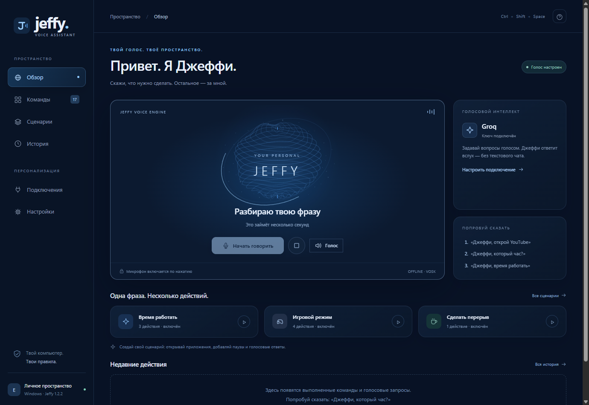
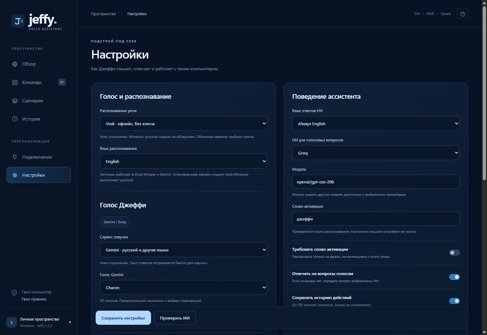

# Jeffy 1.2.2 · Astra Motion

Концепция из предоставленного пользователем дизайн-брифа: тёмно-синее рабочее пространство, физические пружины, плавная смена состояний, стеклянная глубина и последовательное появление контента. Адаптировано к существующему приложению Electron. Движок анимаций использует Web Animations API с рассчитанными пружинными кадрами, а перемещение подсветки — интегратор массы и пружины.

## Изменения

- Русский текст разрешён в Groq Orpheus экспериментально и отправляется без перевода. Английская модель может произносить его с акцентом и искажениями; качество русской речи зависит от провайдера.
- Groq Whisper больше не получает принудительный `language=ru` в автоматическом режиме. Gemini также получает инструкцию сохранять исходный язык записи.
- По умолчанию ИИ отвечает на языке последнего вопроса. Можно выбрать всегда русский или всегда английский.
- Настройки входного и выходного языка сохраняются. Установленные локальные модели Vosk/Windows остаются русскими; для английской речи выбирайте Groq Whisper или Gemini.
- Пружинное перемещение выделенного пункта меню, пружинный отклик кнопок, FLIP-переходы полей при смене сервиса озвучки, последовательное появление панелей и кинетические заголовки.
- Полупрозрачные слои, обводки и глубина, пружинная подсветка за курсором в голосовой панели, инерционная реакция сферы и дуга состояния.
- В простое непрерывная перерисовка сферы остановлена. При уменьшении движения отключаются пружинные анимации и бесконечная перерисовка. Частота кадров зависит от устройства и дисплея; 120 FPS не заявляется как измеренный результат.

## Настройка английского разговора

В «Настройках» выберите распознавание **Groq Whisper** или **Gemini**, язык распознавания **Автоматически**, язык ответов **Как в вопросе**. Для конкретного языка также доступны **Русский** и **English**. Сохраните настройки. Ключ выбранного распознавателя и сервиса озвучки добавляется в «Подключениях».

## Файлы

```text
public/
  motion.js       — полный движок пружин, навигации, FLIP и подсветки
  app.js          — интерфейс, языковые настройки и голосовая сфера
  styles.css      — тёмно-синяя палитра, стекло и reduced-motion
src/
  providers.mjs   — распознавание без перевода и язык ответа
  cloud-speech.mjs — облачная озвучка, включая русский текст Groq
  server.mjs      — настройки, API и сохранение
tests/
  languages.test.mjs
scripts/
  verify_bilingual_live.mjs
  verify_cloud_ui.cjs
```

Полные исходники находятся в перечисленных файлах. Установка зависимостей: `npm.cmd ci`, запуск: `npm.cmd start`, проверки: `npm.cmd run check` и `npm.cmd test`, сборка: `npm.cmd run dist`.

## Skill Finder

Поиск выполнен через `npx.cmd --yes skills find ui animation`, после просмотра каталога skills.sh. Найдены и проверены источник и распространённость:

- [emil-design-eng](https://skills.sh/emilkowalski/skills/emil-design-eng): 362.4K установок на момент поиска. Установка при необходимости: `npx skills add emilkowalski/skills --skill emil-design-eng`.
- [find-animation-opportunities](https://skills.sh/emilkowalski/skills/find-animation-opportunities): 188.1K установок в результатах поиска. Установка при необходимости: `npx skills add emilkowalski/skills --skill find-animation-opportunities`.

Источник — [emilkowalski/skills](https://github.com/emilkowalski/skills), около 47.2K звёзд на момент проверки. Для реализации также прочитан уже установленный `emilkowalski-motion`. Пользовательские глобальные скиллы и настройки Codex не изменялись.

## Проверено 18 октября 2026 года

- Синтаксис и 33 автоматических теста: прошли.
- Живой Groq Whisper: английская тестовая запись распознана как `What is 2 plus 2?`. Живой ответ Groq: `2 plus 2 is 4.`.
- Живая озвучка Groq: английская фраза — 138276 байт WAV, русская — 84516 байт WAV, 24000 Гц. Это проверка получения аудио; качество произношения не оценивалось.
- Electron UI с тестовыми облачными HTTP-ответами: оба предпрослушивания, сохранение голосов и обоих языков после перезагрузки, индикатор меню, состояния сферы и отключение активных анимаций при динамическом `prefers-reduced-motion`.





Проверка повторена с ресурсами собранного `app.asar`: оба предпрослушивания, языковые настройки после перезагрузки и reduced-motion прошли. Упакованный сервер выполнил офлайн-команду времени и создал WAV ответа.
