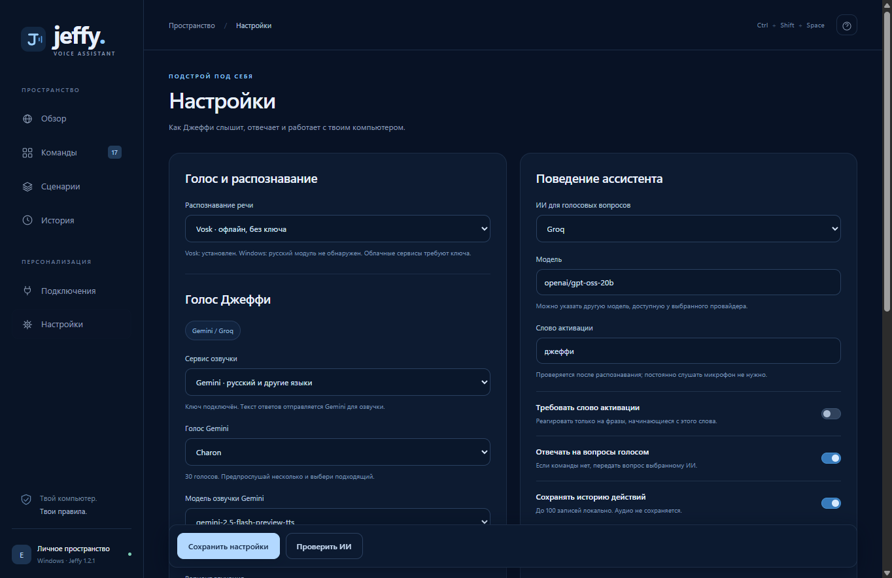

# Облачные голоса в Jeffy 1.2.1

1. Добавьте ключ в **Подключения → Google Gemini** или **Groq**. Если ключ нужен после перезапуска, включите **Запомнить на этом ПК**.
2. Откройте **Настройки → Голос Джеффи**. Выберите сервис озвучки, затем голос. Для Gemini можно отдельно выбрать TTS-модель.
3. Введите короткий текст и нажмите **Послушать этот голос**.
4. Нажмите **Сохранить настройки**. Выбранный сервис и голос применяются к ответам и всем репликам сценариев.

Gemini выбран по умолчанию для русской облачной озвучки. Доступны 30 голосов, включая Kore, Puck, Charon, Fenrir и Zephyr. Варианты моделей: `gemini-2.5-flash-preview-tts`, `gemini-3.1-flash-tts-preview`, `gemini-2.5-pro-preview-tts`. Квоты и доступ зависят от аккаунта, модели и региона; предпрослушивание показывает фактический результат подключения.

Groq Orpheus English предоставляет Troy, Austin, Daniel, Autumn, Diana и Hannah. Этот вариант предназначен для английского; для русского выберите Gemini. Длинный текст делится на части не более 200 символов, WAV-ответы объединяются. Если Groq требует принять условия модели, приложение показывает соответствующее сообщение; условия принимаются пользователем в консоли Groq.

Распознавание речи, модель ответов ИИ и сервис озвучки выбираются отдельно. Например: Groq Whisper → ответ Groq → голос Gemini. Для озвучки нужен ключ именно выбранного TTS-провайдера. Ключи используются сервером приложения; текст для озвучки передаётся выбранному облачному сервису. Windows остаётся локальным вариантом в списке сервисов.

Громкость применяется к полученному аудио обоих провайдеров. В Gemini скорость и высота передаются как пожелания к звучанию; точность зависит от модели и голоса. Для Groq эти два регулятора отключены.

## Проверка 16 октября 2026 года

- Проверка синтаксиса и 29 автоматических тестов прошли. Проверены схема запросов, заголовки с ключами, выбранные голоса, PCM → WAV, громкость, разбиение длинного текста Groq, объединение WAV и восстановление выбора после перезапуска.
- Реальный Groq-запрос с уже сохранённым ключом вернул WAV: 145956 байт, PCM 24000 Гц. Исправлена обработка потокового WAV Groq с неизвестной длиной (`0xffffffff`); приложение формирует стандартные длины WAV для воспроизведения.
- Живой Gemini TTS **не проверен**: сохранённого ключа Gemini в проекте не было. Схема запросов и декодирование его аудио проверены с тестовыми HTTP-ответами.
- Интерфейс Electron с ресурсами из собранного `app.asar`: переключены оба сервиса, выполнены два предпрослушивания с тестовыми аудиоответами, сохранены Charon и Hannah, выбор восстановлен после фактической перезагрузки страницы. Проверены скрытие неподходящих полей, английский текст предпрослушивания Groq и отключение неподдерживаемых регуляторов.
- Проверка упакованного приложения: Vosk распознал команду времени, команда выполнена, локальный вариант озвучки вернул WAV. Проверки использовали отдельные временные данные.

Исходники и документация: [Gemini TTS](https://ai.google.dev/gemini-api/docs/generate-content/speech-generation), [Gemini 2.5 Flash TTS](https://ai.google.dev/gemini-api/docs/models/gemini-2.5-flash-preview-tts), [Groq Orpheus](https://console.groq.com/docs/text-to-speech/orpheus).

Проверки: `npm.cmd run check`, `npm.cmd test`, `node scripts/run_packaged_smoke.mjs`. `scripts/verify_cloud_ui.cjs` запускается через `node_modules/electron/dist/electron.exe` без `ELECTRON_RUN_AS_NODE`; `JEFFY_VERIFY_PACKAGED=1` выбирает собранный `app.asar`. `node scripts/verify_cloud_live.mjs` выполняет живые TTS-запросы только для провайдеров с уже сохранёнными ключами и выводит сведения об аудио без ключей.
