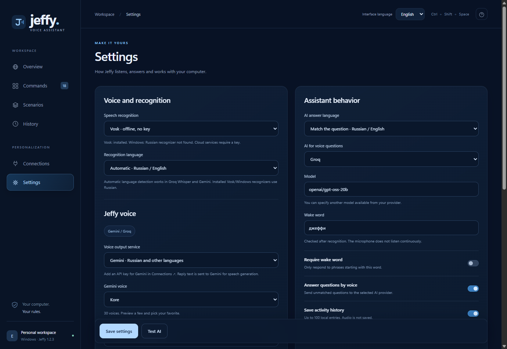
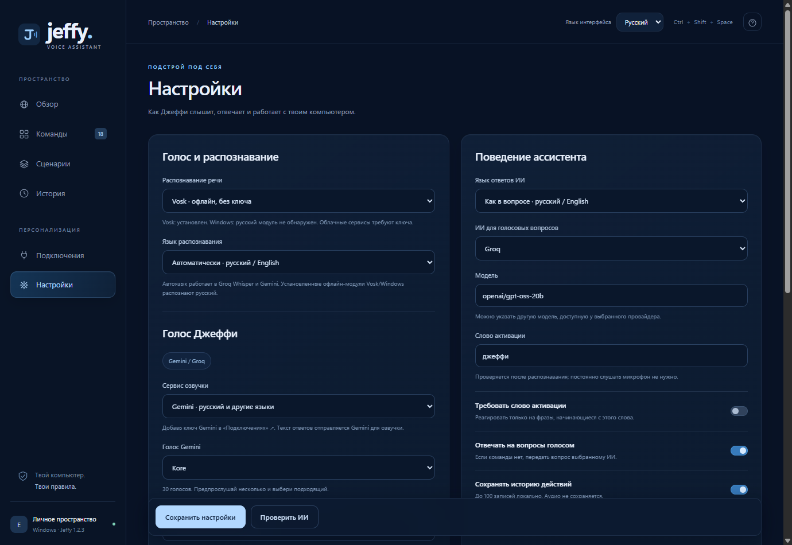

# Jeffy 1.2.3 · Русский / English

Переключатель языка находится справа в верхней панели. Выберите **Русский** или **English**. Изменения применяются сразу и сохраняются после перезапуска. Настройки распознавания и языка ответов ИИ остаются независимыми.

The interface language selector is in the top-right toolbar. Select **Русский** or **English**. Your choice applies immediately and survives a restart. Speech recognition and AI answer language are separate settings.

Переведены меню, настройки, редактор команд, доступные имена элементов, справка, подсказки и сообщения приложения. Встроенные названия команд переводятся только при сохранённом исходном имени и идентификаторе. Собственные названия, голосовые фразы, пути, значения действий и реплики не переводятся. Поиск учитывает отображаемое название встроенной команды и её сохранённые фразы.

Navigation, settings, the command editor, accessibility labels, help, hints and application messages are localized. Built-in names are translated only when both their original name and ID match. Custom names, phrases, paths, action values and spoken text are preserved. Search includes displayed built-in names and saved voice phrases.

`README.md` содержит полноценные русскую и английскую части: запуск, языки, голосовые сервисы, офлайн-режим, команды, хранение данных, проверки и публикация. The README now contains complete Russian and English sections covering setup, languages, speech services, offline mode, commands, data storage, testing and releases.

Проверено 18 октября 2026 года:

- Синтаксис и 35 автоматических тестов прошли.
- В Electron проверены обе локали и все шесть разделов, редактор команды и обратное переключение на русский.
- Выбор английского интерфейса пережил полный перезапуск локального сервера.
- Несохранённая модель в форме настроек сохранилась при смене языка, не записавшись в постоянные настройки.
- Собственная команда с названием «Настройки», фразой «Все» и репликой «Сохранить» сохранила исходные значения в английском интерфейсе.
- Отдельные тесты проверяют, что локализация не меняет интерполированные пользовательские данные и внутренние значения полей, включая русские идентификаторы категорий.

Основные файлы / Main files: `public/i18n.js`, `public/app.js`, `public/index.html`, `src/server.mjs`, `src/electron.cjs`, `tests/i18n.test.mjs`, `scripts/verify_i18n_ui.cjs`.

Проверка повторена в ресурсах готового `app.asar`: оба языка, английский поиск Notepad, сообщение об отсутствии ключа на английском и сохранение после перезапуска прошли. Упакованный сервер также распознал офлайн-команду времени и создал голосовой WAV-ответ.
