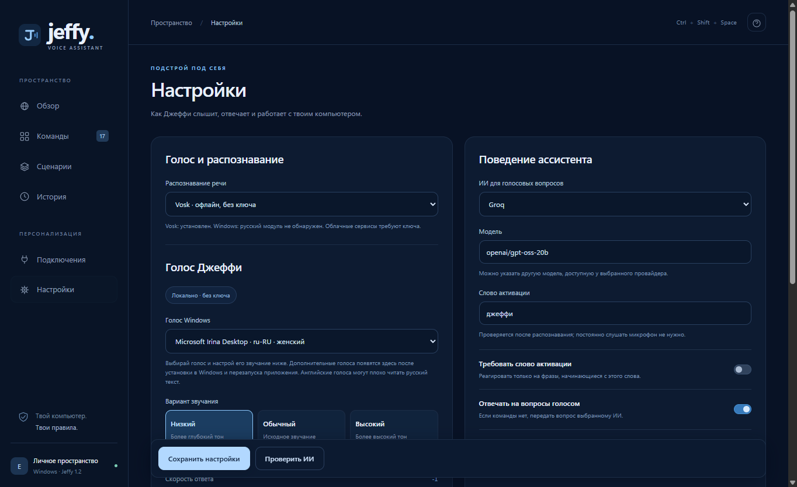

# Голос Jeffy 1.2.0

В обзоре нажмите **Голос**, либо откройте **Настройки → Голос Джеффи**.

1. Выберите голос из установленных совместимых голосов Windows.
2. Выберите низкий, обычный или высокий тон. Это варианты высоты одного выбранного голоса.
3. Настройте скорость и громкость. Громкость относится только к синтезируемой речи Jeffy.
4. Проверьте звучание своим текстом и нажмите **Сохранить настройки**. Кнопка сохранения остаётся внизу окна при прокрутке.

Параметры сохраняются локально и применяются к ответам ассистента и репликам сценариев. Предпрослушивание использует несохранённые значения, не заменяя сохранённые настройки. Дополнительные голоса должны поддерживать Windows SAPI; после установки перезапустите приложение.

Проверено 16 октября 2026 года:

- Проверка синтаксиса и 23 автоматических теста: прошли. Проверены сохранение после перезапуска сервера, временное предпрослушивание, параметры реплик сценариев и отклонение недопустимых значений.
- Реальные Microsoft Irina Desktop (ru-RU), Zira Desktop и David Desktop (en-US): все создали WAV. Низкая и высокая высота изменили аудио относительно исходной. Громкость 20% уменьшила максимальную амплитуду с 15713 до 1571. Текст с символами `<`, `>` и `&` синтезируется корректно.
- Тест интерфейса Electron с файлами из `app.asar`: выбран голос, изменены высота, скорость и громкость, получен реальный WAV предпрослушивания (223074 байта), настройки сохранены и восстановлены после перезагрузки. Проверены видимость кнопки сохранения и отсутствие горизонтального переполнения в окне 1380 × 900.
- Проверка упакованного приложения: Vosk распознал «джефи который час», выполнена команда времени и получен WAV ответа. Для проверки использованы отдельные временные данные.

Воспроизводимые проверки из корня проекта: `npm.cmd run check`, `npm.cmd test`, `node scripts/verify_windows.mjs`, `node scripts/run_packaged_smoke.mjs`. Для интерфейса запускайте `scripts/verify_voice_ui.cjs` через `node_modules/electron/dist/electron.exe` без переменной `ELECTRON_RUN_AS_NODE`; установите `JEFFY_VERIFY_PACKAGED=1`, чтобы проверять ресурсы из собранного `dist/win-unpacked/resources/app.asar`.
